# Read — Minimalist EPUB & Document Reader

**Read** is a modern, high-performance desktop application for reading e-books and documents. Built with **Tauri v2**, **TypeScript**, and **Rust**, it offers an offline-first, distraction-free reading experience with neural text-to-speech, a local AI assistant, built-in dictionary lookups, spaced-repetition vocabulary learning, bionic focus reading, and deeply customizable typography.

## 🖥️ Platform Support

Currently released for **Windows 11** (installers below) — **macOS support is coming soon**. Linux isn't packaged yet either, but the app builds and runs from source on all three via Tauri.

➡️ **[Download the latest Windows release](https://github.com/Emindu/epub-reader/releases/latest)**

---

## 📸 Screenshots

| | |
|---|---|
| **Library** — grid view with per-book progress | **Reader** — auto-hiding chrome, live progress bar |
| 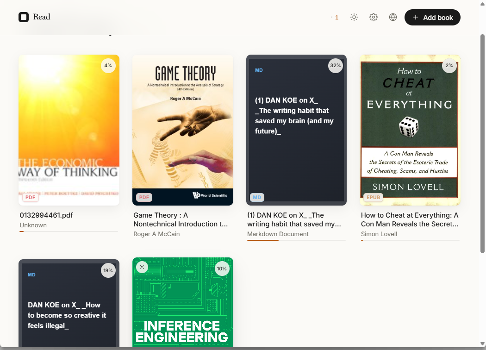 | 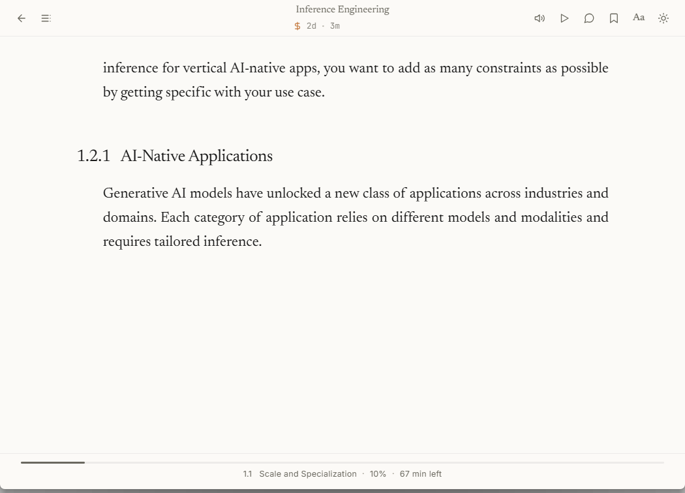 |
| **Table of Contents** — chapters, bookmarks, highlights & vocab in one drawer | **Typography** — 7 fonts, layout, size, line height, margins |
| 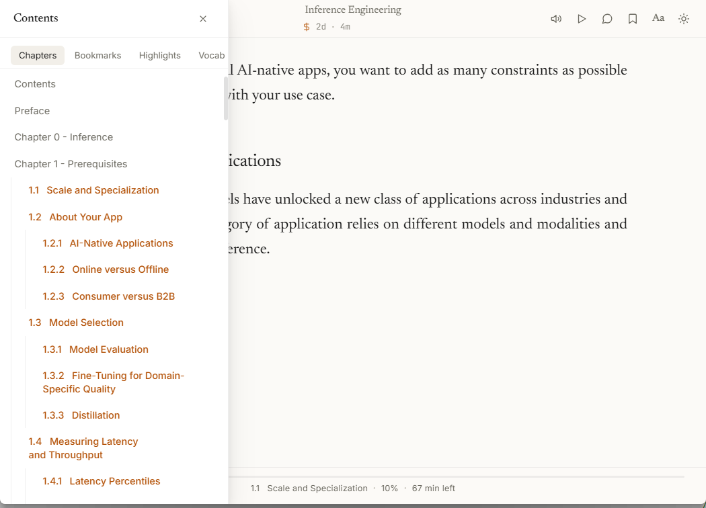 | 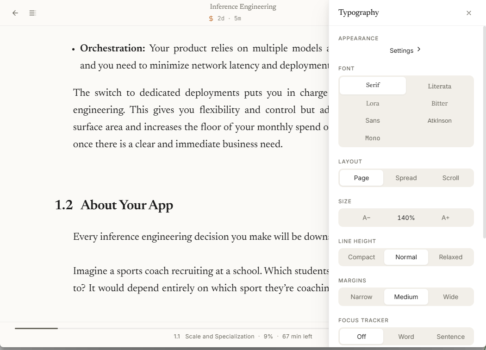 |
| **Neural TTS** — Piper voices with live sentence highlighting | **Focus Mode** — auto-advancing word/sentence tracker |
| 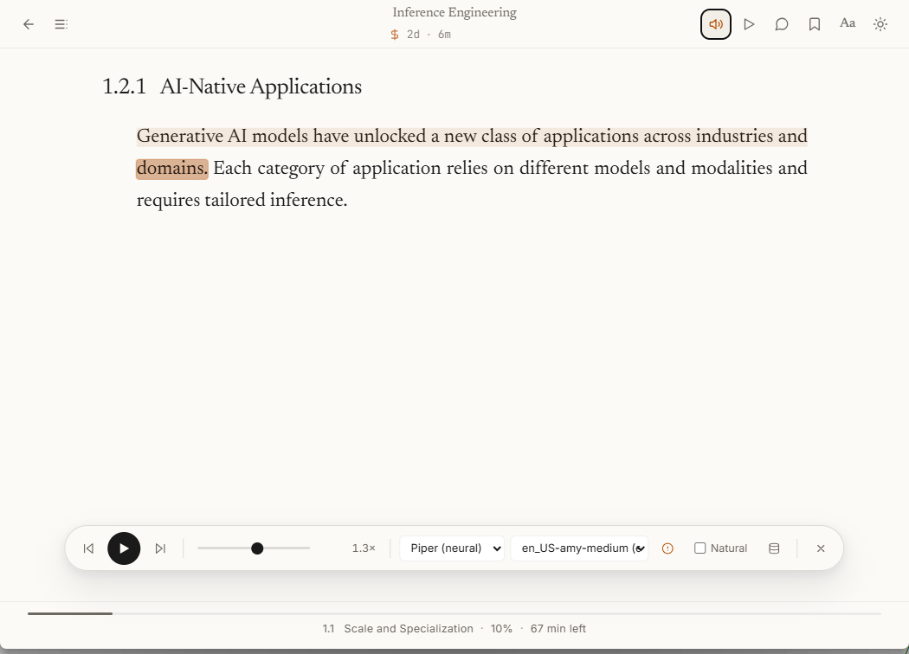 | 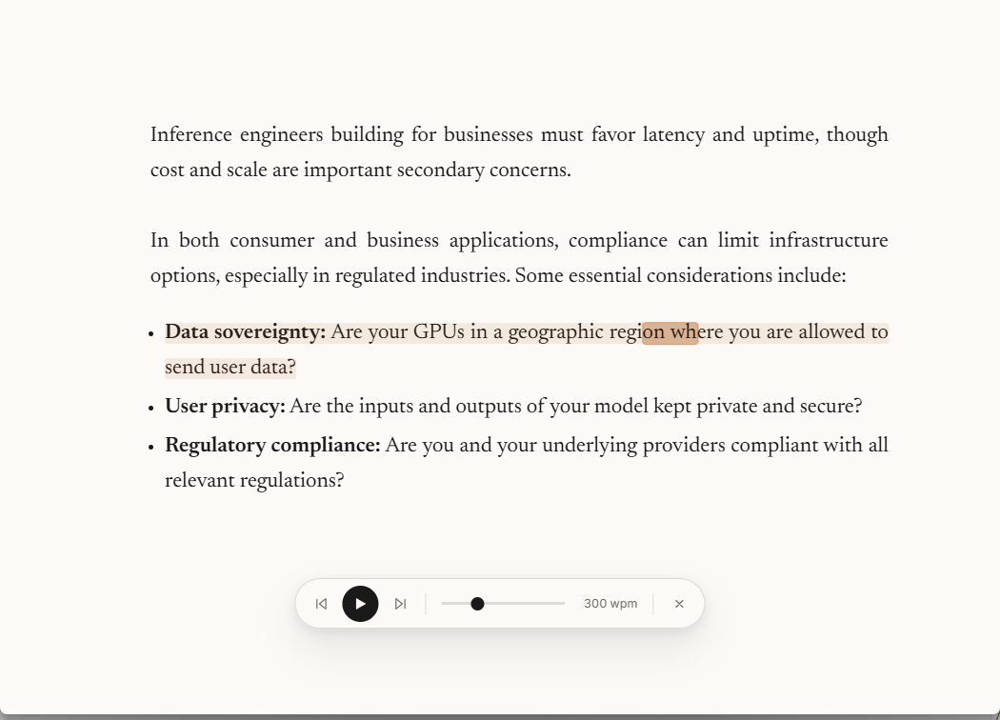 |
| **Dictionary** — instant lookup, phonetics, highlights | **AI "Explain in Context"** — local LLM disambiguates the word as used in the sentence |
| 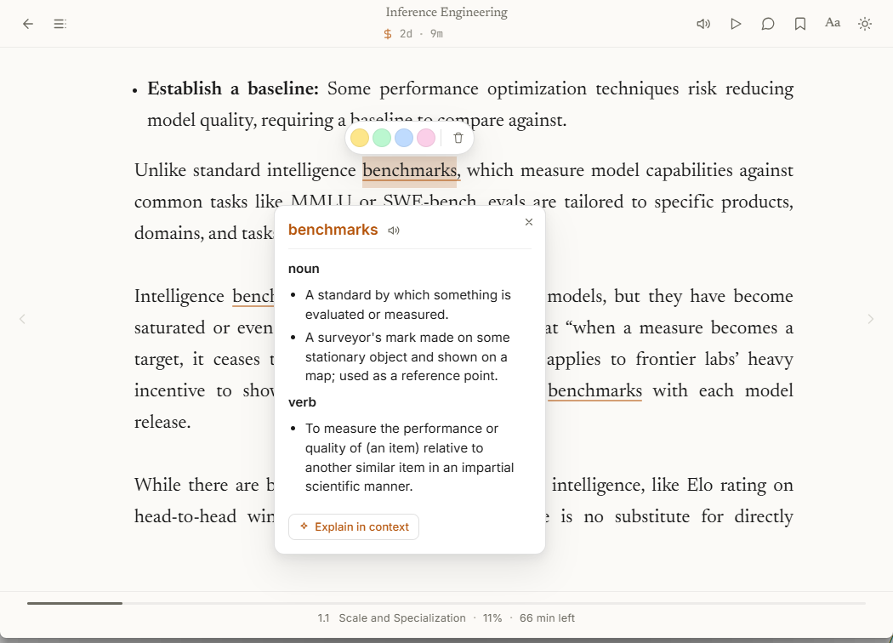 | 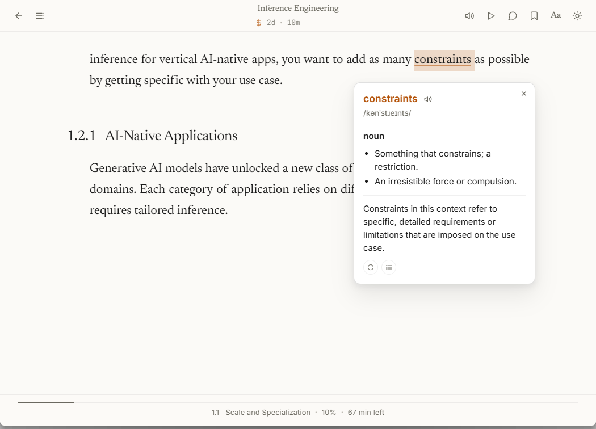 |
| **AI Example Sentences** — fresh, on-demand usage examples for the same word | |
| 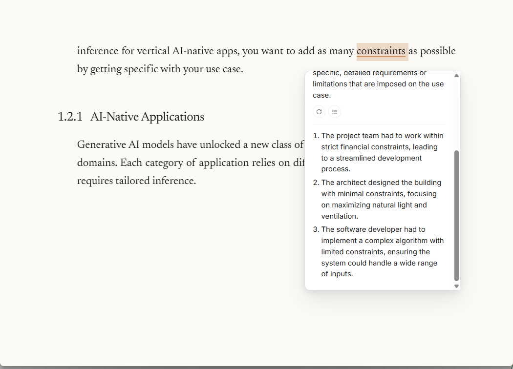 | |
| **Vocabulary Review** — SM-2 spaced-repetition flashcards | **Themes** — 16 curated color palettes |
| 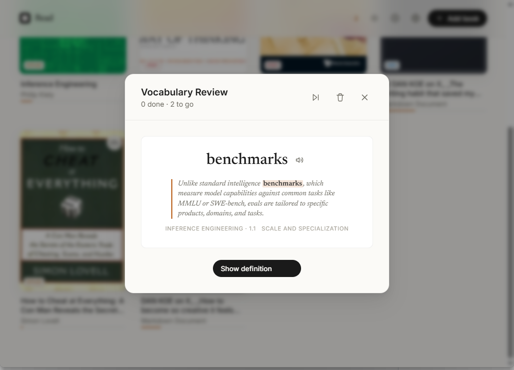 | 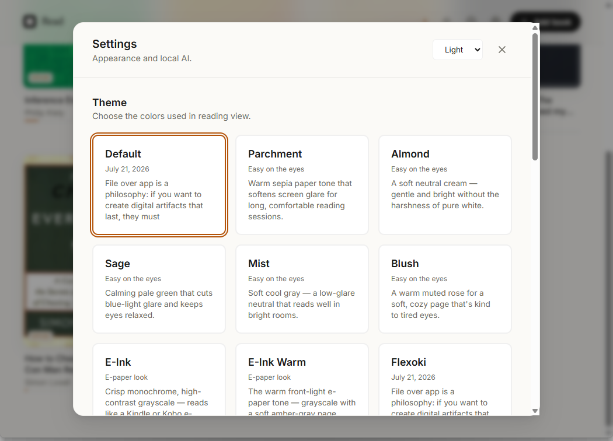 |
| **Local AI** — on-device LLM engine & model manager | |
| 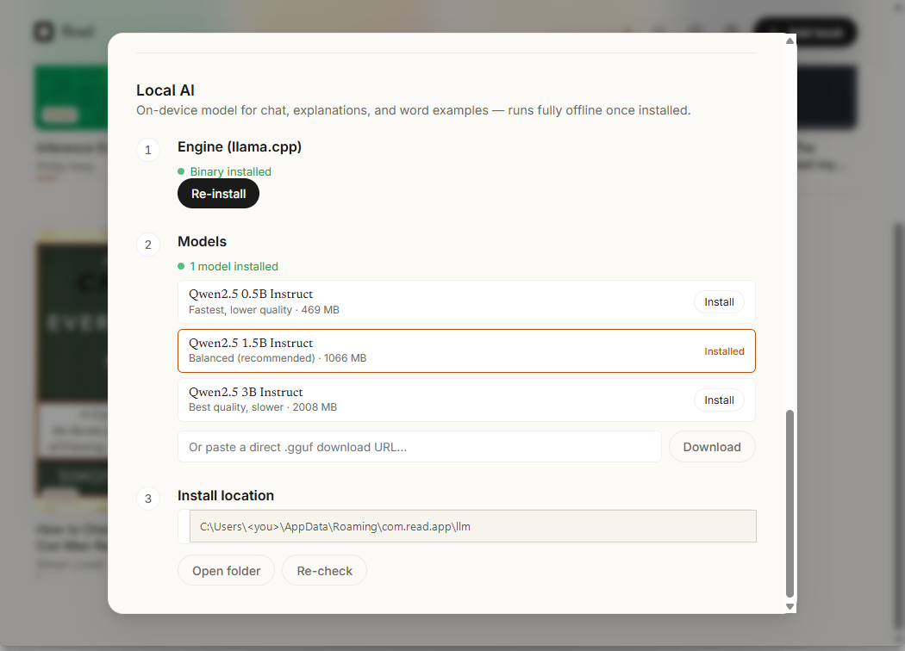 | |

---

## ✨ Features

### 📖 Multi-Format Document Reader
- **Supported Formats**: Full support for **EPUB**, **PDF**, **Plain Text (.txt)**, and **Markdown (.md)** files.
- **Web Article Import**: Paste a URL to pull in any web article — extracted with Mozilla Readability, sanitized, and converted to Markdown — so it drops straight into your library and gets full typography, dictionary, TTS, and focus-mode support like any other book.
- **Reading Modes**: Switch between **Paginated**, **Two-Page Spread**, and **Continuous Scroll** layouts.
- **Table of Contents & Navigation**: A single drawer combines the chapter tree, bookmarks, highlights, and saved vocabulary for the current book, with page estimation, progress percentages, and time-remaining per chapter.
- **Reflow & Window Management**: Automatic responsive reflow on window resize or minimization without breaking reading location.

### 🎧 Neural Text-To-Speech (TTS) & Audiobook Mode
- **Piper Neural TTS Integration**: Embedded Rust engine to download and execute offline high-quality neural voice models (ONNX models via Piper), with live sentence highlighting as it reads.
- **System Speech Engine**: Built-in fallback to native OS Web Speech API voices.
- **Audiobook Pre-Caching ("Batch Synthesis")**: Cache entire chapters into high-fidelity WAV files with sentence timestamp tracking for instant, seamless playback.
- **Playback Controls**: Adjustable speech rate (0.5x – 2.0x), natural pitch preservation option, sentence/word skipping, and automatic chapter progression.

### 🧠 Local AI Assistant & Vocabulary Journal (SRS)
- **On-Device LLM (llama.cpp)**: A built-in settings panel manages a bundled `llama.cpp` engine and a catalog of GGUF models (Qwen2.5 0.5B / 1.5B / 3B Instruct, or any custom `.gguf` URL) — fully offline once installed, no API keys required.
- **Chat About This Page**: Ask the local model questions about the current page or chapter directly from the reader toolbar.
- **Instant Dictionary Lookup**: Select any word to instantly view definitions, phonetics, and pronunciation (via Free Dictionary API).
- **AI "Explain in Context"**: The local model explains what a word means *as used in the sentence* — disambiguating senses, idioms, and technical terms — plus AI-generated example sentences. See [AI Smart Dictionary Architecture](docs/ai-smart-dictionary-architecture.md).
- **Contextual Flashcards**: Automatically saves the surrounding sentence context when adding words to your vocabulary list.
- **SM-2 Flashcard Review System**: Built-in spaced repetition algorithm to review saved words with "Again", "Good", and "Easy" ratings, with a daily new-card cap to prevent review pile overwhelm.

### ⚡ Bionic Focus & Speed Reading
- **Focus Reading Mode**: Auto-advancing word/sentence highlight tracker with adjustable speed (WPM), play/pause, and next/previous controls.
- **Focus Tracker (in Typography)**: Toggle word- or sentence-level highlight follow-along while reading normally, independent of the dedicated focus mode.

### 🎨 Design & Typography Engine
- **16 Curated Themes**: Default, Parchment, Almond, Sage, Mist, Blush, E-Ink, E-Ink Warm, Flexoki, Ayu, Catppuccin, Everforest, Gruvbox, Nord, Rosé Pine, and Solarized — including two dedicated grayscale "E-Ink" looks for e-paper-style reading.
- **Appearance Modes**: Dark Mode and Light Mode support with smooth transition effects.
- **7 Font Families**: Serif (*Newsreader*), Literata, Lora, Bitter, Sans (*Inter*), Atkinson (Hyperlegible), and Monospace (*JetBrains Mono*), with custom line heights (Compact/Normal/Relaxed), text scaling, and margin widths (Narrow/Medium/Wide).

### 📌 Bookmarks, Highlights & Analytics
- **Multi-Color Highlights**: Yellow, Green, Blue, and Pink highlight annotations attached to book locations (EPUB CFI), editable from an inline color-picker popover.
- **Bookmarks**: Quickly pin locations within any book or chapter.
- **Reading Statistics**: Streak tracking (consecutive days read) and total reading time log.
- **Local Library Storage**: Imported books are safely adopted into `AppData` for persistent offline reading.

---

## 🏗️ Architecture

Read uses a decoupled architecture separating the lightweight native OS shell (Rust/Tauri) from the web presentation and reader engines (TypeScript/HTML/CSS).

```
┌─────────────────────────────────────────────────────────────────┐
│                      Frontend UI (Webview)                      │
│                                                                 │
│  ┌───────────────────────┐ ┌─────────────────────────────────┐  │
│  │     Library View      │ │          Reader Screen          │  │
│  │ (Book Grid, Storage)  │ │ (Epub.js, PDF.js, Marked.js)    │  │
│  └───────────────────────┘ └─────────────────────────────────┘  │
│                                                                 │
│  ┌───────────────────────┐ ┌─────────────────────────────────┐  │
│  │   Vocabulary & SRS    │ │    Speed Reading & Focus      │  │
│  │     (SM-2 Engine)     │ │        (RSVP Engine)            │  │
│  └───────────────────────┘ └─────────────────────────────────┘  │
└────────────────────────────────┬────────────────────────────────┘
                                 │ Tauri IPC Commands / Events
┌────────────────────────────────┴────────────────────────────────┐
│                      Tauri Backend (Rust)                       │
│                                                                 │
│  ┌───────────────────────┐ ┌─────────────────────────────────┐  │
│  │ Native Filesystem     │ │  Piper Neural TTS Manager       │  │
│  │ (App Data Storage)    │ │  (Status, Download, Synthesize) │  │
│  └───────────────────────┘ └─────────────────────────────────┘  │
│                                                                 │
│  ┌───────────────────────┐ ┌─────────────────────────────────┐  │
│  │ Chapter Audio Cache   │ │  Binary / Voice Archiver        │  │
│  │ (WAV Concatenation)   │ │  (Curl + Tar Subprocesses)      │  │
│  └───────────────────────┘ └─────────────────────────────────┘  │
│                                                                 │
│  ┌───────────────────────┐                                     │
│  │ Local LLM Manager     │                                     │
│  │ (llama.cpp + GGUF)    │                                     │
│  └───────────────────────┘                                     │
└─────────────────────────────────────────────────────────────────┘
```

### Component Breakdown

1. **Backend Shell (Rust / Tauri v2)**:
   - Location: [`src-tauri/`](file:///d:/One%20Drive/OneDrive%20-%20D%20F%20N%20TECHNOLOGY%20%28PVT%29%20LTD/Documents/personal/epub-reader/src-tauri/)
   - **`lib.rs`**: Core Tauri commands for Piper TTS engine control (`piper_synthesize`, `piper_batch_synthesize`), model download manager (`piper_download_file`), voice catalogue indexing, and file unarchiving via system `curl` / `tar`. Also hosts the local LLM smart-dictionary and chat commands (`llm_status`, `llm_explain`) that drive a bundled `llama-cli` subprocess — see the [AI Smart Dictionary Architecture](docs/ai-smart-dictionary-architecture.md) doc for diagrams and the output-parsing pipeline.
   - **Tauri Plugins**: Uses `tauri-plugin-fs` for persistent app storage, `tauri-plugin-dialog` for native open dialogs, `tauri-plugin-clipboard-manager` for copy actions, and `tauri-plugin-opener` for native folder navigation.

2. **Frontend Layer (TypeScript / Vite)**:
   - Location: [`src/`](file:///d:/One%20Drive/OneDrive%20-%20D%20F%20N%20TECHNOLOGY%20%28PVT%29%20LTD/Documents/personal/epub-reader/src/)
   - **`main.ts`**: Single-page application logic driving library management, reader engine lifecycle, theme management, dictionary popups, vocabulary flashcards, reading statistics, local LLM chat, and speech controls.
   - **`styles.css`**: Design system tokens, glassmorphic dark/light UI themes, typography styling, custom scrollbars, and drawer transitions.
   - **`index.html`**: Semantic structure for Library and Reader screens, drawer panels, popovers, and dialogs.

3. **Core Rendering Engines**:
   - **EPUB**: Rendered via `epubjs` into an iframe sandbox with custom CSS overrides for theme synchronization.
   - **PDF**: Rendered via `pdfjs-dist` using web worker threads (`pdf.worker.min.mjs`).
   - **Markdown / Text**: Rendered natively via HTML DOM and compiled through `marked`.
   - **Web Articles**: Extracted with `@mozilla/readability`, sanitized with `dompurify`, and converted to Markdown with `turndown` before joining the Markdown reading pipeline.

---

## 🛠️ Development & Building

### Prerequisites
- [Node.js](https://nodejs.org/) (v18+)
- [Rust](https://www.rust-lang.org/) (v1.75+)
- Windows, macOS, or Linux — packaged installers currently ship for Windows 11 only; macOS builds are in progress, and other platforms run from source in the meantime.

### Setup
```bash
# Clone the repository
git clone https://github.com/Emindu/epub-reader.git
cd epub-reader

# Install dependencies
npm install

# Run application in development mode
npm run tauri dev
```

### Production Build
```bash
# Build the native application binary
npm run tauri build
```

---

## 📄 License

MIT
